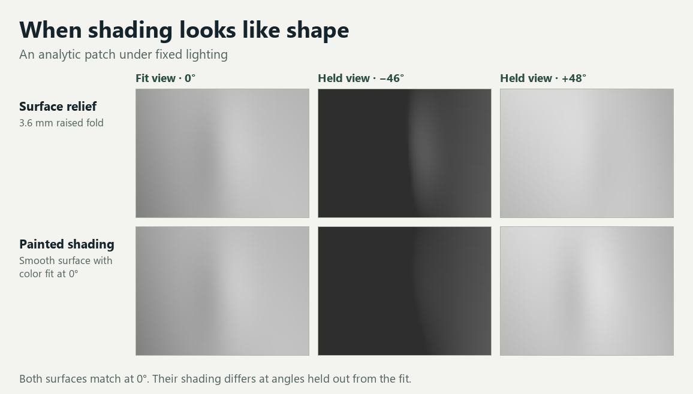

# Local 3D Studio

Local 3D reconstruction from clothed photos. Generate a vertex-colored GLB from a photo you can use, inspect it in a browser, and run a synthetic benchmark that tests when shading supports a claim about surface geometry.

[Run the CPU benchmark](#run-the-cpu-benchmark) · [Reconstruct a photo](docs/photo-reconstruction.md) · [Contribute](CONTRIBUTING.md)

## Run the CPU benchmark

You need Python 3.10 or 3.11. The benchmark generates its own inputs and runs on a CPU without checkpoints.

```sh
git clone https://github.com/yuanrui3/local-3d-studio.git
cd local-3d-studio
python -m venv .venv
```

Activate with `source .venv/bin/activate` on macOS or Linux, or `.\.venv\Scripts\Activate.ps1` in PowerShell. Then run these commands.

```sh
python -m pip install -r requirements.txt
python -c "from pathlib import Path; Path('outputs').mkdir(exist_ok=True)"
python -m experiments.held_orientation_relief_v001 --output outputs/held-relief.json
python -m unittest test_held_orientation_relief_v001
```

The command prints `"passed": true` and writes `outputs/held-relief.json`. Use a fresh output filename on a repeat run. The benchmark makes two surfaces look identical from the front by painting equivalent shading onto one. It uses reserved oblique views to test whether the fitted relief reproduces the shading across cameras, and abstains when lighting, reflections, view coverage, or registration make that comparison unreliable.



[Benchmark method and outputs](docs/held-view-benchmark.md)

To inspect the generated surface in 3D, run `python -m http.server 8000 --bind 127.0.0.1` from the repository root, then open the [local synthetic preview](http://127.0.0.1:8000/viewer.html?model=docs/assets/synthetic-patch.glb).

## Reconstruct a photo

The [photo reconstruction guide](docs/photo-reconstruction.md) covers Python dependencies, pinned TripoSR model downloads, foreground preparation, and GLB export. It includes the commands for opening `viewer.html` locally and inspecting a generated GLB. Source photos stay on your machine during reconstruction.

Treat single-photo outputs as visual estimates. Inspect coverage and silhouette from other angles before relying on the mesh. Reserve real views separately for evaluation when you have them.

## Contribute

Reproducible setup reports, CPU-friendly fixtures, and improvements to camera, mask, and held-view evaluation are welcome. Use the [contribution guide](CONTRIBUTING.md) for testing and review expectations, [Issues](https://github.com/yuanrui3/local-3d-studio/issues) for bugs and proposals, or [Discussions](https://github.com/yuanrui3/local-3d-studio/discussions) for usage questions.

## License

The project’s original code and documentation are available under the [MIT License](LICENSE). [Third-party notices](THIRD_PARTY_NOTICES.md) cover upstream code, weights, and the bundled viewer. This release contains synthetic fixtures and code. Bring photos you have permission to use and download optional models under their upstream terms.
